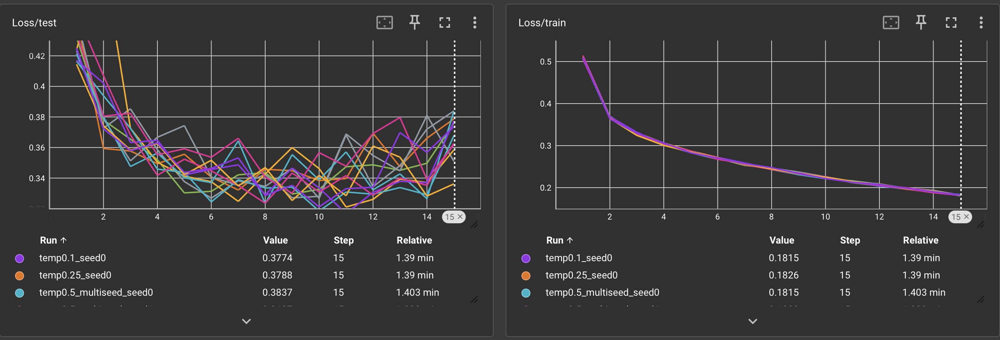
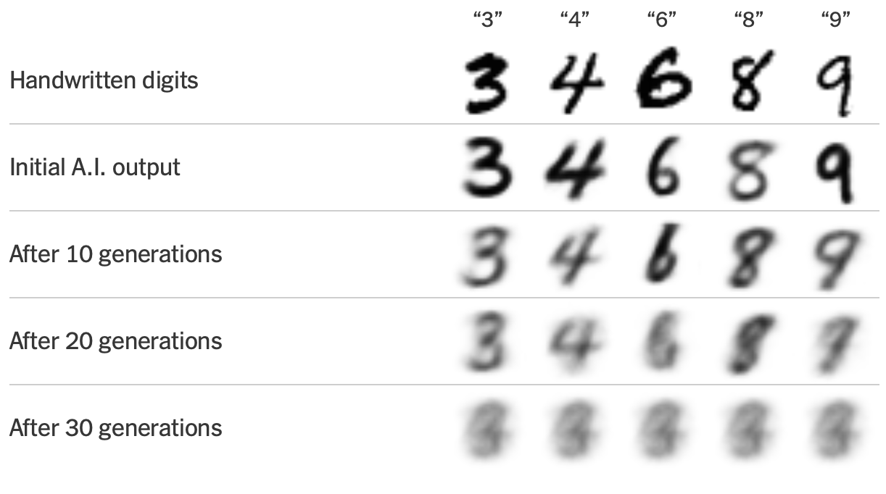
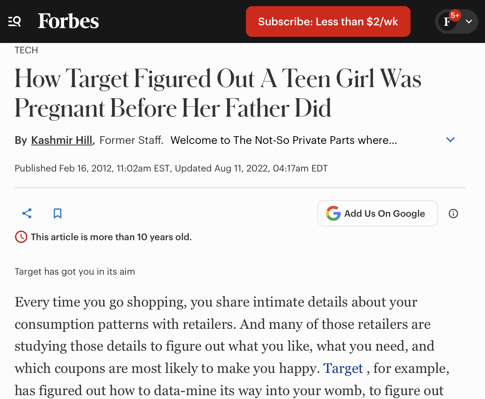
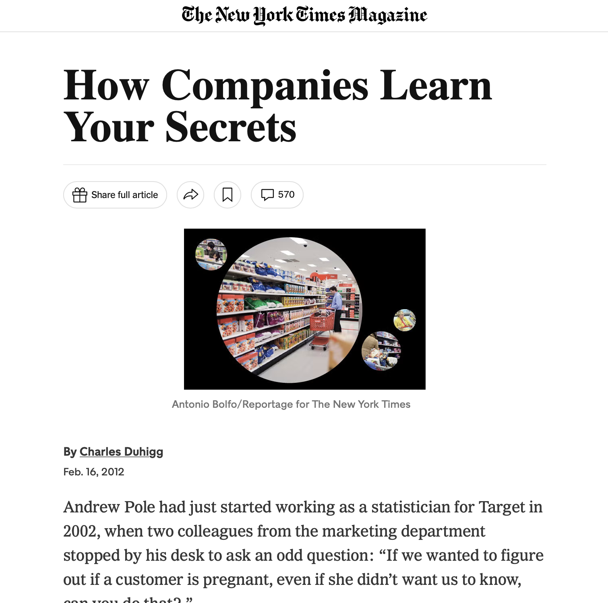

## What is generative AI?

Generative AI learns patterns from data and uses them to produce new content.

- Text models generate text.
- Image models generate images.
- Audio models generate sound.

**Plausible output is not necessarily true output.**

::: notes
A simplified way to understand a large language model is that it learns patterns in language and generates text by predicting likely continuations, one piece at a time.

Other generative models work differently, but the general idea is that they learn structure from examples and use it to create something new.

This is useful for drafting, summarizing, brainstorming, and creating images. But generating something that looks or sounds convincing is not the same as verifying that it is correct.
:::

## More complex doesn't always mean better

**The goal is to perform well on data the model has never seen.**

{fig-alt="Test loss rises after step 10 while training loss keeps falling" width=95% fig-align="center"}

*Training loss keeps improving. Test loss turns back up.*

::: notes
[Point at the right graph first, then the left.]

On the right, the training loss goes down at every step. If that were the only graph I looked at, I'd say the model keeps getting better.

On the left is the same set of runs on data the model didn't train on. The test loss improves until about step 8 to 10, then gets worse. The model keeps getting better at the training data while getting worse at new data. That's overfitting.

The different colored lines are different settings and seeds from my research. The test curves are noisy, but they all turn upward together, so the trend isn't a fluke.

A model that is too simple may miss important patterns. A model that is too complex, or trained too long, may memorize the training data instead of learning patterns that generalize. That is why we hold out data and test performance on observations the model did not train on.

This applies to traditional statistical models and machine learning. A generative AI system can also produce fluent answers while getting important details wrong. Fluency is not a validation metric.
:::
## Garbage in, garbage out

A model can only work with the information and assumptions it receives.

- Biased or incomplete data can create biased results.
- Poorly chosen outcomes can answer the wrong question.
- A model can perform well on paper and fail in practice.

**Before asking whether the model works, ask what it was built to do.**

::: notes
A model is not automatically objective just because it uses mathematics. The choice of data, outcome, features, and evaluation criteria all matter.

If a company trains a hiring model using historical hiring decisions, the model might learn historical preferences and discrimination rather than identify the best employees.

The problem may not be a coding error. It may be that the model is learning the wrong lesson from the data.
:::

---

[Diffusion Article Examples](https://arxiv.org/html/2311.12202v2)

---

## When the model affects real people

**Cathy O'Neil — *Weapons of Math Destruction***

- NYC teacher evaluations used value-added models to estimate teachers' contributions to student test scores.
- Hiring algorithms can reproduce patterns in historical hiring data.
- High-stakes scores can be difficult for affected people to challenge.

Stat 121 refresh for ethical use: Scale, Opacity, Damage

::: notes
O'Neil argues that some models become especially harmful when they operate at scale, are difficult to inspect, and affect people's opportunities.

The New York City teacher evaluation example illustrates the limits of using a statistical score to represent a complicated human outcome. Student scores can reflect many things beyond a teacher's performance.

For the hiring example, verify the specific case you want to mention before presenting it as a factual example from the book. Avoid naming a CEO-resume case unless you have confirmed the exact story and its source.

The lesson is not that every model is bad. It is that a model's consequences matter, especially when people cannot see how it works or appeal its decisions.
:::

## Accurate doesn't always mean ethical

::: {.columns}
::: {.column width="55%"}
**Target's pregnancy-prediction example**

A retailer used purchasing patterns to infer that some customers might be pregnant.

- Potential benefit: more relevant marketing.
- Potential harm: sensitive inferences and unexpected exposure.

**Just because we can predict something doesn't mean we should use it.**
:::
::: {.column width="45%"}
{fig-alt="Forbes article on Target pregnancy prediction" width=60%}

{fig-alt="NYT article on Target pregnancy prediction" width=60%}

*Sources: Forbes, The New York Times*
:::
:::

::: notes
This example, popularized in reporting about Target's analytics, illustrates the difference between predictive accuracy and responsible use.

The business objective might be to predict future purchases. But the model may infer something deeply personal, and its output may affect how a customer is treated.

Ethical questions include consent, privacy, potential harm, and whether the benefit justifies the inference.

The point is not that prediction itself is unethical. The point is that we need to consider what is being predicted, why, and what happens after the prediction.
:::

## The model is only part of the advantage

**Data + domain knowledge + validation**

My experience:

::: {.columns}
::: {.column width="30%"}
{width=100%}

{width=100%}
:::
::: {.column width="70%"}
{width=100%}
:::
:::

::: notes
For my project, the challenge was not simply choosing an algorithm. It was deciding which data was relevant to the upcoming Olympic tournament.

The 2026 Olympics brought NHL players back for the first time since 2014, so relying only on older Olympic data would have missed an important change in the player pool.

I combined 2022 Olympic data with Four Nations Face-Off data, then used Monte Carlo validation to assess the approach. That combination of context, data selection, and validation helped me win the competition.

The model mattered. But knowing the sport helped me decide what information the model should use in the first place.
:::

## What happens when everyone has the model?

When everyone can access similar tools, access alone stops being a lasting advantage.

**The advantage shifts toward:**

- Better data
- Better questions
- Better evaluation
- Better implementation
- Better judgment

::: notes
This is a caveat to Moneyball. The original advantage came partly from using an approach that other teams undervalued or ignored.

Once everyone adopts similar tools, the advantage can shrink. That doesn't mean models become useless. It means that simply possessing a model is not enough.

A team may still win by collecting better data, identifying a better question, understanding context, or executing its decisions more effectively.

The same applies to generative AI in business. If everyone has access to a similar assistant, the advantage comes from how people use it and how well they check the result.
:::

## AI has limitations. People have responsibilities.

Before trusting a model, ask:

1. What question is it actually answering?
2. What data and assumptions shaped it?
3. How was it evaluated on new cases?
4. Who could be harmed if it is wrong?
5. Who is responsible for the final decision?

::: notes
These questions connect technical evaluation to ethics.

A model can be useful without being perfect, but the acceptable level of error depends on the decision. A mistake in a brainstorming exercise is different from a mistake in hiring, education, medicine, or lending.

We need to understand not only whether a model performs well, but also whether it is appropriate for the decision we want to make.
:::

## "Do Your Job"

**A model can assist with the task. It cannot take responsibility for the outcome.**

::: notes
Bill Belichick's "Do Your Job" philosophy is often interpreted as a call for discipline, preparation, and accountability within a team.

Applied to AI, the lesson is not to reject the tool or follow it blindly. It is to understand your role when using it.

If you use AI to analyze data, you are still responsible for checking the analysis. If you use it to make a recommendation, you are still responsible for understanding the consequences.

The tool can help you do your job. It does not remove the obligation to do your job well.
:::

## The model always isn't the answer

**Good decisions require more than good predictions.**

They require:

- Sound data
- Appropriate models
- Honest evaluation
- Ethical judgment
- Human accountability

::: notes
[Close by returning to the opening photograph.]

The model is never the whole decision.

AI and statistics can help us see patterns that we might otherwise miss. But we still need to decide what to measure, what the results mean, and what we should do with them.

The goal isn't to replace judgment with models. It's to use models to make better judgments.
:::
